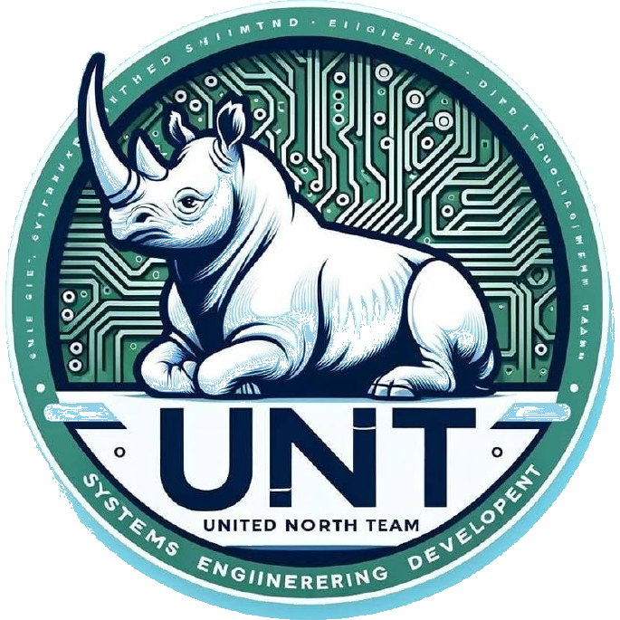

<p align="center">
  
</p>

# KynicOS 🐕

**Asistente operativo de Julián Juárez — UNT Tecnologías Computacionales Cancún**

KynicOS **no es un concierge de hotel**. Es el asistente personal y de
infraestructura del jefe: corre en hardware propio, con modelo local, y vive en
Telegram, la web y WhatsApp. Piensa, ejecuta skills, vigila el nodo y se
actualiza solo en cada reinicio.

> No es un chatbot: es el nodo primario que orquesta el resto del ecosistema.
> Los modos de concierge (LEO, MueveCancún, Nexus) siguen existiendo como
> personas opcionales, pero el default y el propósito del proyecto es el
> asistente.

<!-- STATUS:START -->
> 🧠 **Asistente con contexto persistente** | 🔌 **Multi-proveedor LLM** | 🧰 **6 skills operativas** | 💾 **Sesiones en disco** | 🐕 **Sentinel en vivo** | 🔄 **Arranque idempotente** | 🧪 **CI en verde**
<!-- STATUS:END -->


## 🚀 Arranque

Una sola llave maestra: **`nodo\kynikos.ps1`** (o doble clic en `nodo\ARRANCAR.cmd`).

```powershell
cd $HOME\Documents\KynicOS
git pull
.\nodo\kynikos.ps1
```

Sin argumentos hace el flujo completo y verifica cada paso. Para el menú visual: `.\nodo\kynikos.ps1 centro`.

**Todos los comandos, subcomandos y el mapa de archivos: → [docs/ARRANQUE.md](docs/ARRANQUE.md)**

Ese documento es la fuente única. Cualquier otro que repita comandos de arranque está obsoleto por definición (ADR-031).

## 🎯 Qué hace hoy (verificado el 6-nov-2026)

| Área | Estado | Evidencia |
| --- | --- | --- |
| Nodo en Windows | Operativo | Proceso vivo, polling de Telegram activo, `VALIDADO: el nodo esta escuchando a Telegram` |
| Arranque | Idempotente | La tarea de inicio compara commit con GitHub, verifica dependencias por huella y arranca solo si hace falta (ADR-033) |
| Autoconocimiento | Verificado | Responde con su configuración real; `/info` no pasa por el modelo (ADR-036) |
| Intención | Corregida | Detección por palabra completa; ya no contesta rutas a quien saluda (ADR-035) |
| Enlaces | Vivos | App de rutas apunta a Vercel (200), no al Render suspendido (503) |
| CI | Verde | Suite de pruebas en verde; `KynicOS Tests` sin fallos |

### Comandos del bot

| Comando | Qué hace |
| --- | --- |
| `/info` | Ficha técnica real: modelo, stack, máquina, repo, commit |
| `/estado` | Salud: modelo, contexto, PID, RAM, polling |
| `/version` | Commit local frente al último publicado en GitHub |
| `/logs` | Últimas líneas del registro |
| `/modelo`, `/id`, `/reiniciar`, `/ayuda`, `/start` | Modelo activo, ID de Telegram, reinicio del polling, lista, saludo |

### Habilidades (skills locales)

| Skill | Qué resuelve |
| --- | --- |
| `hvac_triage` | Diagnóstico de fallas de climatización con escalado por prioridad |
| `mueve_cancun` | Rutas de transporte en Cancún con enlaces vivos |
| `web_research` | Investigación web estructurada |
| `last30days` | Resumen de los últimos 30 días de actividad |
| `memory_manager` | Lectura y escritura de la memoria compartida |
| `skill_builder` | Creación de skills nuevas desde plantilla |

### Canales y conectores

| Canal / proveedor | Estado |
| --- | --- |
| Telegram (`@kynicOS_robot`) | **Activo**, por polling |
| Web (`POST /api/chat`, PWA en `web/`) | Disponible en el nodo |
| WhatsApp (Twilio) | Código listo, **desactivado** por falta de credenciales |
| Ollama local | **Activo**, último recurso y default en el nodo |
| Groq / Anthropic | Se activan solos si existen sus claves en el `.env` |
| GitHub | Autorizado para trabajo de repositorios |

**Límite conocido:** `/api/status` no exige autenticación. No debe exponerse al
exterior (túnel o puerto abierto) hasta protegerlo con la palabra de dos pasos
(ADR-032).

## 🔀 PRs pendientes de merge

Barrido del 6-nov-2026 con la API de GitHub. Regla: máximo un PR abierto por
persona y repo; nada se mergea sin revisión de Julián.

| Repositorio | PRs | Contenido y criterio |
| --- | --- | --- |
| `KynicOS` | 0 | Limpio |
| `KYNYKOS_AI_Agent` | 10 | Personas Jules. Prioridad: #49 y #19 (seguridad, `shell=True`), #52 y #50 (rendimiento en el enrutado de la skill de transporte), #53/#51 (accesibilidad), #43/#39 (rendimiento), #35/#30 (limpieza) |
| `MueveCancun` | 10 | Nueve son `dependabot` (astro, vite, sharp, node). Se agrupan en una sola actualización; el #596 (caché O(1)) se revisa aparte |
| `Wasm-Kalpixk_IA_DevOps` | 10 | Ocho de Sentinel con correcciones reales de seguridad (timestamps UTC, `request.client` nulo, subprocess). Agrupar en un PR de seguridad |
| `cantabria-pms-demo` | 2 | `dependabot`: `@types/node` y `astro`. Merge directo si el CI está en verde |
| `JULIANJUAREZMX01.github.io` | 1 | #2: migración de Jules y bucle de entrenamiento. Revisión de contenido, no de código |
| `python-orchestrator-node`, `sanaciones-cuanticas` | 0 | Limpios |

## 🗺️ Roadmap

**Ahora (cerrado):** nodo estable, arranque idempotente, autoconocimiento, detección
de intención y enlaces vivos.

**Siguiente (corto plazo)**

1. Proteger `/api/status` con autenticación de dos pasos antes de exponer nada.
2. `/instalar` en el bot: leer el registro y decir en qué paso falló, en lugar de
   mandar al jefe a probar a mano.
3. Triaje de los 10 PRs de `KYNYKOS_AI_Agent`: los de seguridad primero.
4. Agrupar los `dependabot` de `MueveCancun` y `cantabria-pms-demo` en un solo PR
   por repo, con CI verde.

**Medio plazo**

5. Capa visual del centro de mando: panel web en el propio FastAPI (ADR-032).
6. WhatsApp real cuando existan las credenciales de Twilio.
7. Segundo cerebro: memoria consultable desde el bot, no solo archivos.

**Largo plazo**

8. Evaluar consolidación de `app/` entre KynicOS y KYNYKOS_AI_Agent, módulo por
   módulo y con ADR propio. La divergencia actual es intencional (ADR-034).

## 🔗 Quick Links

| Recurso | URL |
| :--- | :--- |
| 🏠 Repositorio | [github.com/JULIANJUAREZMX01/KynicOS](https://github.com/JULIANJUAREZMX01/KynicOS) |
| 🚀 Deploy actual | [nanobot-cloud-zjr0.onrender.com](https://nanobot-cloud-zjr0.onrender.com) |
| 📋 Roadmap AMD | [ROADMAP_AMD.md](./ROADMAP_AMD.md) |
| ⚙️ Orquestador | [tools/README.md](./tools/README.md) |
| 🧪 CI | [.github/workflows/test.yml](./.github/workflows/test.yml) |
| 🔐 Variables de entorno | [.env.example](./.env.example) |

---

## 🎯 Mission

KynicOS nace de una necesidad operacional concreta: **convertir una conversación en una acción verificable**.

Su propósito actual es ser el **asistente del jefe**: responder, ejecutar y
vigilar. El entorno hotelero (Cantabria, MueveCancún) fue el primer campo de
pruebas y sigue siendo un caso de uso válido, pero ya no define el producto.

Ejemplo de esa cadena, heredado de ese primer caso:

```text
"Mi habitación no tiene frío."
```

Pero el sistema necesita convertirla en una cadena operacional:

```text
Huésped
   ↓
Canal de entrada
   ↓
AgentContext
   ↓
ConciergeAgentLoop
   ↓
deteccion de skill (HVAC / MueveCancun)
   ↓
HVAC Triage
   ↓
Diagnóstico / prioridad
   ↓
Ticket de mantenimiento
   ↓
Notificación al técnico
   ↓
Persistencia de sesión
   ↓
Seguimiento
```

El objetivo de KynicOS es que esa cadena sea **repetible, observable, extensible y verificable**.

---

# 🧠 Architecture

KynicOS utiliza una arquitectura por capas en la que el LLM no constituye por sí mismo el sistema. El modelo razona dentro de un runtime que proporciona contexto, memoria, skills, proveedores y herramientas.

Los nombres de este diagrama son los del código: las skills se detectan con reglas explícitas dentro de `ConciergeAgentLoop.process_message` (import directo de cada skill, sin enrutador genérico); la memoria se carga desde `workspace/memory/MEMORY.md` con `Memory.get_memory_context`; los proveedores los resuelve `ProviderManager` y las herramientas `ToolExecutor`.

```text
┌─────────────────────────────────────────────────────────────────┐
│                         KynicOS Runtime                          │
├─────────────────────────────────────────────────────────────────┤
│                                                                 │
│  WhatsApp / Telegram / API                                      │
│              │                                                  │
│              ▼                                                  │
│       ConciergeAgentLoop                                        │
│              │                                                  │
│      ┌───────┴────────┐                                         │
│      ▼                ▼                                         │
│  Skills de dominio  Memory                                     │
│      │                │                                         │
│      └───────┬────────┘                                         │
│              ▼                                                  │
│        ProviderManager                                          │
│      ┌───────┼────────┐                                         │
│      ▼       ▼        ▼                                         │
│    Groq  Anthropic  Ollama                                     │
│              │                                                  │
│              ▼                                                  │
│        ToolExecutor                                             │
│              │                                                  │
│       ┌──────┼───────────────┐                                  │
│       ▼      ▼               ▼                                  │
│      HVAC   MueveCancún   Custom Skills                         │
│       │                                                          │
│       ▼                                                          │
│  Maintenance Escalation                                         │
│                                                                 │
├─────────────────────────────────────────────────────────────────┤
│ Context │ Sessions │ Memory │ Sentinel │ Tools │ Dashboard      │
└─────────────────────────────────────────────────────────────────┘
```

### Core architectural principles

1. **Context before inference** — the agent receives durable session state before asking the LLM to reason.
2. **Skills before generic generation** — deterministic operational intents are routed to explicit skills whenever possible.
3. **Provider fallback** — failure or unavailability of one LLM provider does not have to terminate the conversation path.
4. **Persistence** — conversations, state, files and timestamps survive process boundaries through session storage.
5. **Observability** — logs and Sentinel monitoring provide a runtime control layer.
6. **Evidence before conclusions** — static inspection and runtime execution are deliberately separated.
7. **Controlled extensibility** — generated skills are validated before registration; validation is hardening, not a security sandbox.

---

# 👤 Personas / Operating Modes

KynicOS can operate under different personas without changing the underlying orchestration runtime.

| Persona | Variable | Purpose |
| :--- | :--- | :--- |
| `leo` | `PERSONA=leo` | Luxury hospitality concierge |
| `nexus` | `PERSONA=nexus` | Personal / administrative AI operator |
| `mueve` | `PERSONA=mueve` | Cancún transportation assistant |

The persona controls presentation, tone and system-level instructions. The operational runtime remains shared.

---

# 🔌 LLM Provider Architecture

KynicOS uses a provider abstraction so the orchestration layer is not coupled to a single AI vendor.

```text
                    ProviderManager
                          │
              ┌───────────┼───────────┐
              ▼           ▼           ▼
            Groq      Anthropic     Ollama
              │           │           │
              └───────────┴───────────┘
                          │
                          ▼
                    Agent Response
```

### Current provider strategy

- **Groq** — primary cloud provider in the current deployment path.
- **Anthropic** — cloud fallback.
- **Ollama** — local provider path for environments where a local model is available.

Provider configuration is handled through the application settings and environment variables.

> **Important:** provider availability is an operational/runtime condition. The presence of provider code in the repository does not prove that a provider is configured or reachable in a particular deployment.

---

# 🧰 Operational Skills

KynicOS separates deterministic operational functionality from free-form LLM reasoning.

## HVAC Triage

The HVAC skill recognizes common air-conditioning symptoms and can produce:

- operational response;
- priority classification;
- probable diagnostic information;
- estimated response time;
- maintenance escalation through Telegram when configured.

Example flow:

```text
"No enfría la habitación"
        ↓
HVAC symptom detection
        ↓
Issue classification
        ↓
Priority
        ↓
Guest response
        ↓
Maintenance escalation
```

The escalation path is defensive against incomplete diagnostic payloads. If a diagnostic list is empty, the ticket can still be constructed with an explicit fallback indicating that technical inspection is required.

## MueveCancún

The MueveCancún skill provides transportation-oriented responses and route information through the KynicOS orchestration layer.

The objective is to keep transportation logic in a specialized skill rather than forcing the general-purpose LLM to reproduce route logic from memory.

## Memory Manager

Provides the runtime path for persistent memory operations.

## Web Research

Provides controlled research functionality through the tool/skill architecture.

## Skill Builder

Provides the framework for creating and registering additional skills. Generated Python is subjected to static AST validation before registration.

> **Security boundary:** AST validation reduces obvious dangerous constructs but does **not** constitute a process sandbox, container isolation or capability-based execution environment. Generated Python remains code executed by the application runtime.

---

# 💾 Context, Memory & Sessions

KynicOS distinguishes three related but different concepts:

### AgentContext

The active execution context contains:

- session identifier;
- user identifier;
- communication channel;
- message history;
- mutable state;
- registered files;
- session start timestamp;
- message metadata and timestamps.

Operational fields such as:

```text
room_number

guest_name
```

are represented as durable context state rather than ephemeral attributes.

### Session persistence

Sessions are persisted through JSONL snapshots and reconstructed when loaded.

The persistence layer preserves the context required to continue a conversation across process boundaries.

> The current implementation is **snapshot persistence**, not a complete event-sourcing system. It does not imply immutable event replay semantics.

### Memory

Memory persistence is application data. It is **not model training** and there is no evidence in this repository of modifying LLM weights through the memory system.

---

# 🐕 Runtime Sentinel

The Sentinel monitors the KynicOS log stream for operational failure indicators such as:

```text
ERROR
CRITICAL
EXCEPTION
FAILED
```

Its lifecycle is integrated with the FastAPI application:

```text
Application startup
       ↓
LogSentinel created
       ↓
Sentinel task started when enabled
       ↓
Log monitoring
       ↓
Alerts / operational signals
       ↓
Application shutdown
       ↓
Sentinel stopped and task cancelled
```

### Auto-healing status

KynicOS contains configuration and architectural hooks for automatic healing, but a complete autonomous healing strategy is **not** claimed by this README.

The distinction matters:

| Capability | Status |
| :--- | :--- |
| Log monitoring | Implemented |
| Failure detection | Implemented |
| Alert path | Implemented / configuration dependent |
| Sentinel lifecycle | Implemented |
| Automatic repair policy | Partial / framework level |
| Autonomous self-repair | Not demonstrated |

---

# 🔄 Agent Orchestration

The Concierge loop is the central decision layer.

```text
Incoming message
      ↓
Context update
      ↓
Detector de skills
      │
      ├── Known operational intent
      │        ↓
      │      Execute skill
      │
      └── Unknown / conversational intent
               ↓
          Inject memory/context
               ↓
             LLM call
               ↓
          Parse tool/skill directives
               ↓
        Execute / persist response
```

This creates a hybrid architecture:

- **deterministic execution** where an operational skill exists;
- **probabilistic reasoning** where general language understanding is required;
- **persistent state** across interactions;
- **tool execution** as an explicit runtime capability.

---

# 🧠 Engineering Model: Cognitive OS

KynicOS uses the term **Cognitive OS** as an architectural analogy.

The analogy is based on the separation of responsibilities:

| OS concept | KynicOS equivalent |
| :--- | :--- |
| Process | Agent execution |
| Context | `AgentContext` |
| Memory | Persistent memory/session storage |
| Scheduler | Agent / skill routing |
| Drivers | Channels and providers |
| Programs | Skills |
| Monitoring | Sentinel |
| System calls | Tools |
| Configuration | Settings / environment |

This does **not** mean that KynicOS is an operating system kernel, nor that the system possesses consciousness.

---

# 🧩 Extensibility Levels

The project can be evaluated through increasing autonomy levels:

### L1 — Reactive

Receives a message and produces a response.

### L2 — Contextual

Uses conversation state and persistent information.

### L3 — Tool / Skill Orchestration

Selects operational capabilities and executes skills.

### L4 — Self-monitoring

Detects runtime failures and exposes alert/healing mechanisms.

### L5 — Autonomous Evolution

Would require reliable autonomous modification, verification, rollback and deployment policies.

**Current repository evidence supports L1–L4 architectural components, while L5 full autonomous evolution is not demonstrated.**

---

# 🛡️ Security & Trust Boundaries

KynicOS intentionally exposes powerful operational tooling because it is designed as an automation runtime. That makes capability boundaries important.

Security-sensitive surfaces include:

- shell execution;
- subprocess execution;
- dynamic imports;
- generated skill execution;
- file read/write operations;
- Git operations;
- network operations;
- process/system controls;
- self-repair interfaces;
- overdrive execution paths;
- permissive CORS configuration.

The repository therefore treats static security scanning as a **review mechanism**, not as proof of production security.

For generated skills, the current hardening path uses AST validation to reject known dangerous imports and normalize skill identifiers. This should not be confused with sandboxing.

---

# 🧪 Verification & CI

KynicOS includes a GitHub Actions workflow for reproducible Python verification.

```text
Push / Pull Request
        ↓
Ubuntu runner
        ↓
Python 3.11
        ↓
pip install -r requirements.txt
        ↓
pytest -q
```

The repository also contains regression coverage for:

- `room_number` / `guest_name` context properties;
- state removal when values are set to `None`;
- current immutable skill registry;
- dangerous-import validation;
- deterministic skill-name normalization;
- HVAC escalation when diagnostic data is empty.

### Verification philosophy

A result is only considered runtime evidence when it was actually executed.

```text
PASS-STATIC   → Code/configuration verified by inspection
PASS-RUNTIME  → Executed successfully
PARTIAL       → Some required evidence exists
FAIL          → Executed and failed
BLOCKED       → Could not execute because of environment/dependency/tool limits
```

This distinction is fundamental to the KynicOS audit process.

---

# ⚙️ KynicOS Orchestrator

The Windows PowerShell orchestrator lives in:

```text
tools/kynicos.ps1
```

It provides four operating modes:

```powershell
.\tools\kynicos.ps1 -Mode audit
.\tools\kynicos.ps1 -Mode verify
.\tools\kynicos.ps1 -Mode doctor
.\tools\kynicos.ps1 -Mode repair-plan
```

Optional execution switches:

```powershell
-NoInstall
-RunAgents
-RunRuntime
-Workspace <path>
```

The orchestrator can generate timestamped evidence containing:

- repository state;
- architecture inventory;
- static security findings;
- Python verification output;
- Rust verification when applicable;
- runtime `/api/status` evidence when explicitly requested;
- independent audit prompts;
- post-merge regression checklist.

### Safety contract

The orchestrator does not automatically:

- execute `git reset --hard`;
- destructively overwrite a repository;
- commit changes;
- push changes.

Actual repair remains a controlled development operation.

See [`tools/README.md`](./tools/README.md) for the detailed procedure.

---

# 🚀 Quick Start

## Prerequisites

- Python 3.11+
- Git
- Access to the required LLM provider credentials
- Optional: Telegram credentials
- Optional: WhatsApp/Twilio credentials

## 1. Clone

```bash
git clone https://github.com/JULIANJUAREZMX01/KynicOS.git
cd KynicOS
```

## 2. Configure environment

```bash
cp .env.example .env
```

Edit `.env` and provide the credentials required by your deployment.

## 3. Install dependencies

```bash
python -m venv .venv

# Linux/macOS
source .venv/bin/activate

# Windows PowerShell
.\.venv\Scripts\Activate.ps1

pip install -r requirements.txt
```

## 4. Run locally

```bash
uvicorn app.main:app --reload
```

With a specific persona:

```bash
PERSONA=leo uvicorn app.main:app --reload
```

Windows PowerShell:

```powershell
$env:PERSONA="leo"
python -m uvicorn app.main:app --reload
```

## 5. Verify the API

Open:

```text
http://127.0.0.1:8000/api/status
```

Expected response shape:

```json
{
  "status": "ok",
  "version": "1.0.0",
  "pid": 27660,
  "persona": "kynikos",
  "agent_loop": true,
  "telegram_token": true,
  "llm": "groq → anthropic → ollama",
  "channels": ["telegram", "whatsapp"]
}
```

`status` no es una constante. Devuelve `ok` solo cuando `agent_loop` es `true` **y** `telegram_token` es `true`; en cualquier otro caso devuelve `degradado`. Un 200 prueba que el servidor HTTP contestó, no que el agente ni el canal de Telegram funcionen: valida contra esos dos campos, nunca contra el puerto. Decisión registrada en `docs/adr/ADR-030-verificacion-por-api.md`.

The actual channel list depends on configuration.

---

# 📡 Channels

## Telegram

Telegram is optional during startup. If no token is configured, KynicOS can initialize without starting the Telegram polling task.

Configuration:

```text
TELEGRAM_TOKEN
TELEGRAM_USER_ID
TECH_TELEGRAM_CHAT_ID
```

## WhatsApp

WhatsApp integration is provided through the existing bridge architecture and its configured provider credentials.

Typical configuration includes:

```text
TWILIO_ACCOUNT_SID
TWILIO_AUTH_TOKEN
```

The exact deployment configuration should always be taken from `.env.example` and the active provider configuration.

---

# 🌐 API Surface

The FastAPI application exposes operational endpoints including:

| Method | Endpoint | Purpose |
| :--- | :--- | :--- |
| `GET` | `/` | Service/root information |
| `GET` | `/api/status` | Runtime status |
| `GET` | `/api/persona` | Current persona |
| `GET` | `/docs` | FastAPI OpenAPI documentation |

Additional routes may be registered by the dashboard/channel components.

---

# 🗂️ Project Structure

```text
KynicOS/
├── app/
│   ├── agents/
│   │   └── concierge_loop.py       # Main hospitality orchestration loop
│   │
│   ├── channels/
│   │   └── whatsapp_evolution.py   # Channel integration
│   │
│   ├── cloud/
│   │   ├── providers.py             # LLM provider abstraction
│   │   ├── sessions.py               # Session persistence
│   │   ├── telegram_bot.py           # Telegram integration
│   │   ├── whatsapp_bridge.py         # WhatsApp bridge
│   │   └── ...
│   │
│   ├── config/
│   │   └── schema.py                 # Application settings
│   │
│   ├── core/
│   │   ├── context.py                # Agent execution context
│   │   ├── loop.py                   # Generic agent loop
│   │   ├── memory.py                 # Persistent memory
│   │   ├── sentinel.py               # Runtime monitoring
│   │   ├── skill_engine.py           # Dynamic skill loading/validation
│   │   └── tools.py                  # Operational tool layer
│   │
│   ├── concierge/
│   │   └── persona.py                # Persona definitions
│   │
│   ├── skills/
│   │   └── ...                       # Operational skills
│   │
│   └── main.py                       # FastAPI entry point
│
├── tests/
│   ├── test_main.py
│   ├── test_tools.py
│   └── test_regressions.py
│
├── tools/
│   ├── kynicos.ps1                   # Audit/verification orchestrator
│   └── README.md
│
├── .github/
│   └── workflows/
│       └── test.yml                  # CI verification
│
├── .env.example                      # Environment template
├── requirements.txt                  # Python dependencies
├── ROADMAP_AMD.md                    # Roadmap
└── README.md                         # Project documentation
```

---

# 🔧 Development Commands

### Run the application

```bash
python -m uvicorn app.main:app --reload
```

### Run tests

```bash
pytest -q
```

### Compile-check application code

```bash
python -m compileall -q app
```

### Run the KynicOS audit orchestrator on Windows

```powershell
.\tools\kynicos.ps1 -Mode audit
```

### Verify without installing dependencies

```powershell
.\tools\kynicos.ps1 -Mode verify -NoInstall
```

### Verify and execute local runtime check

```powershell
.\tools\kynicos.ps1 -Mode verify -RunRuntime
```

---

# 🧪 Testing Strategy

Testing is organized around the runtime boundaries rather than only individual functions.

### Context tests

Validate that operational context is represented in durable state and can be removed cleanly.

### Skill-engine tests

Validate:

- skill-name normalization;
- immutable skill registry;
- generated-code AST validation;
- rejection of dangerous imports.

### Concierge regression tests

Validate that malformed or incomplete HVAC diagnostic payloads do not prevent ticket escalation.

### CI tests

The GitHub workflow provides an independent Linux execution environment. A successful workflow is stronger evidence than a static repository inspection, but it still does not replace production observability or deployment verification.

---

# 🛠️ Troubleshooting

## Application does not start

1. Confirm Python 3.11+ is installed.
2. Activate the virtual environment.
3. Install `requirements.txt`.
4. Check `.env` values.
5. Run:

```bash
python -m compileall -q app
pytest -q
```

## LLM does not respond

Check provider configuration and credentials.

The presence of a provider in the code does not prove that the provider is available at runtime.

## Telegram does not send alerts

Check:

```text
TELEGRAM_TOKEN
TECH_TELEGRAM_CHAT_ID
```

Then inspect the KynicOS logs for escalation errors.

## HVAC ticket contains no diagnostic

The escalation layer intentionally handles an empty diagnostic list by using a fallback message indicating that technical inspection is required.

## Sentinel is not active

Check the Sentinel configuration fields in the application settings and confirm that the feature is enabled for the current environment.

---

# 📋 Current Capability Matrix

| Capability | State | Evidence Type |
| :--- | :--- | :--- |
| FastAPI runtime | Implemented | Static + runtime-verifiable |
| Concierge AgentLoop | Implemented | Static |
| Multi-provider LLM routing | Implemented | Static |
| Persistent AgentContext | Implemented | Static + regression tests |
| JSONL session persistence | Implemented | Static + regression tests |
| HVAC Triage | Implemented | Static |
| Maintenance escalation | Implemented | Static |
| Empty-diagnostic fallback | Implemented | Regression test |
| MueveCancún skill | Implemented | Static |
| Dynamic skill engine | Implemented | Static |
| Generated skill hardening | Implemented | Static + tests |
| Telegram optional startup | Implemented | Static |
| Sentinel lifecycle | Implemented | Static |
| Runtime auto-healing | Partial | Static |
| Full autonomous evolution | Not demonstrated | Evidence required |
| Local production deployment | Environment dependent | Runtime required |
| CI | Configured | Workflow execution required |

---

# 🗺️ Roadmap

## Phase 1 — Core Runtime

- [x] Unified FastAPI runtime
- [x] Concierge AgentLoop
- [x] Multi-provider LLM routing
- [x] Telegram integration
- [x] WhatsApp bridge
- [x] HVAC Triage
- [x] MueveCancún integration
- [x] Persistent context/session state
- [x] Runtime Sentinel

## Phase 2 — Hotel Operations

- [ ] PostgreSQL operational database
- [ ] Maintenance ticket persistence
- [ ] Guest profile persistence
- [ ] HVAC knowledge/RAG layer
- [ ] Hotel operations dashboard
- [ ] Multi-property support

## Phase 3 — Controlled Autonomy

- [ ] Verified autonomous repair policies
- [ ] Sandboxed generated skills
- [ ] Capability-based tool permissions
- [ ] Automatic rollback
- [ ] Deployment verification gates
- [ ] Multi-agent consensus verification

## Phase 4 — Infrastructure Intelligence

- [ ] Cross-system hotel orchestration
- [ ] Domotics / building automation integration
- [ ] Operational telemetry
- [ ] Predictive maintenance
- [ ] Enterprise multi-hotel control plane

---

# 🔬 Engineering Philosophy

KynicOS is developed around a simple rule:

> **Do not confuse architectural possibility with demonstrated capability.**

The project deliberately separates:

- what exists in source code;
- what is statically verified;
- what has passed automated tests;
- what has actually executed at runtime;
- what remains dependent on deployment configuration;
- what is still a roadmap capability.

This makes the system auditable while preserving room for aggressive experimentation.

### Mentalidad del sujeto

When analyzing KynicOS as an engineering artifact, the project shows recurring patterns of:

- recursive decomposition of operational problems;
- preference for orchestration over isolated scripts;
- separation between deterministic skills and probabilistic LLM reasoning;
- persistence of operational context;
- iterative hardening through regression tests;
- multi-provider fallback strategies;
- interest in autonomous monitoring and repair;
- use of AI as an orchestration component rather than merely a conversational interface.

These observations describe **engineering decisions and implementation patterns**, not psychological or clinical conclusions about the author.

---

# 👤 Author

**Julián Alexander Juárez Alvarado**  
Lead Architect / Full Stack AI & Automation

Cancún, México

> *"La eficiencia no es un lujo técnico, es un imperativo moral."*

---

# 📄 License

See the repository license and individual dependency licenses before redistributing or deploying KynicOS.

---

## ⚡ KynicOS

**Concierge. Context. Skills. Memory. Automation. Orchestration.**

A hospitality AI runtime designed to turn conversations into operational workflows.
