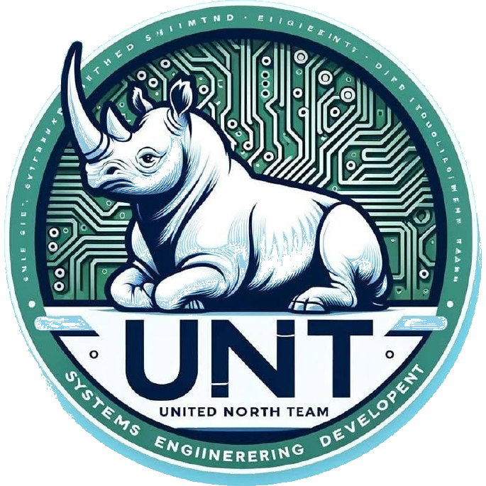

<p align="center">
  
</p>

# KynicOS

**Un asistente de IA que corre en tu propia máquina.**
No es un servicio en la nube. Es un nodo que vive en tu equipo, con tu modelo, tus
reglas y tus datos. Si se cae internet, sigue funcionando. Si el proveedor sube el
precio, no te afecta.

Proyecto de **UNT Tecnologías Computacionales Cancún** · firma **JAJA.DEV**

---

## El problema que resuelve

Los asistentes de IA actuales funcionan al revés de como deberían para un negocio
pequeño: tu información viaja a un servidor ajeno, pagas por cada palabra y no
decides qué modelo responde ni qué sabe de tu operación.

KynicOS invierte eso. El modelo corre en tu computadora, la memoria es tuya y las
decisiones de negocio están escritas en reglas que tú controlas.

---

## Cómo está construido

La idea central: **el modelo de lenguaje no es el sistema**. Es una pieza dentro de
un entorno que le da contexto, memoria, herramientas y límites.

```
   Entradas                    Runtime                     Salidas
 ┌──────────────┐        ┌──────────────────┐        ┌──────────────┐
 │  Telegram    │───────▶│  Razonamiento    │───────▶│  Telegram    │
 │  Navegador   │        │  + memoria       │        │  Navegador   │
 │  API/Webhook │        │  + reglas         │        │  API         │
 └──────────────┘        └──────────────────┘        └──────────────┘
```

Cada mensaje que entra pasa por cuatro capas antes de llegar al modelo:

1. **Canal**: Telegram, navegador o API.
2. **Reglas de negocio**: si la pregunta es de un tema conocido (por ejemplo, un
   reporte de mantenimiento o una consulta de transporte), se responde sin gastar
   cómputo del modelo.
3. **Contexto**: quién habla, qué se habló antes y qué sabe el sistema del negocio.
4. **Modelo**: solo si hace falta razonar. Entonces elige un proveedor y responde.

---

## Qué puede hacer hoy

- **Atender por Telegram** con comandos de operación y conversación libre.
- **Consultar su propio estado**: si está encendido, qué modelo usa, cuánta memoria
  consume, qué versión corre.
- **Responder con conocimiento del negocio**: memoria en archivo, editable a mano.
- **Ampliar capacidades con skills**: piezas de código que se activan según el tema.
- **Diagnosticarse**: si algo falla, revisa sus propios registros y dice qué pasó.
- **Actualizarse desde el chat**: trae la última versión y se reinicia solo.

---

## Límites, dichos sin adornos

La honestidad es parte del diseño:

- **Corre en una PC, no en un servidor.** Si el equipo se apaga, el nodo se apaga.
- **Sin tarjeta gráfica dedicada, el modelo va lento.** Hoy responde alrededor de
  cuatro palabras por segundo en un procesador de consumo. Es usable para
  conversación, no para generar documentos largos.
- **El conocimiento es el del modelo open source**, no una base actualizada al
  minuto. Para datos vivos se conectan herramientas.
- **Un solo dueño.** Está pensado para que una persona o un equipo pequeño lo
  opere y decida qué sabe.
- **No es un producto terminado.** Es infraestructura funcionando, con documentación
  de cada decisión para que otra persona pueda retomarla.

---

## Requisitos

- Windows, Linux o macOS con Python 3.11 o superior
- 8 GB de RAM mínimo (16 recomendado)
- Un modelo local vía Ollama, o llaves de un proveedor en la nube
- Un token de Telegram si se quiere operar desde el teléfono

---

## Estado

Operativo y en uso diario: atiende por Telegram, ejecuta sus comandos, responde con
el modelo local y se mantiene actualizado. Cada decisión técnica está registrada en
`docs/adr/` con su contexto, la decisión y sus consecuencias.

En desarrollo: acceso remoto seguro, autenticación propia en la interfaz web y
compilación del motor de búsqueda en Rust.

---

## Por qué es distinto

Porque se puede auditar. Cada regla está escrita, cada capacidad es una pieza
identificable y cada decisión tiene un documento que explica por qué se tomó. No hay
caja negra: si algo no te gusta cómo funciona, se cambia.

*KynicOS · UNT Tecnologías Computacionales Cancún · JAJA.DEV*
